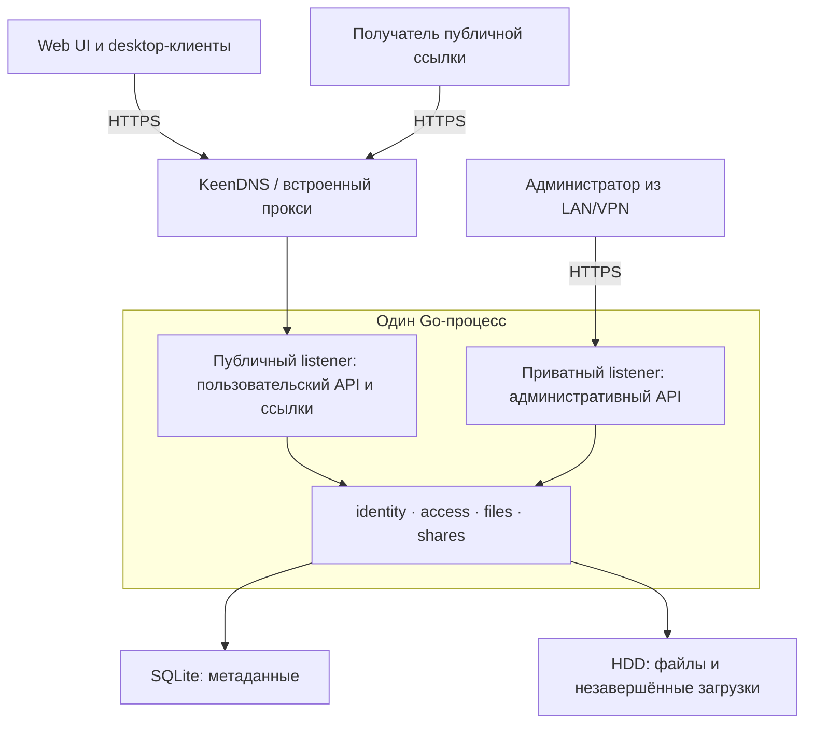

# ShareFile: требования и технический проект

Дата: 4 октября 2026 года.

Статус: продуктовые решения и технический проект подтверждены пользователем; backend и React Web UI реализованы. Desktop-клиенты и испытания роутера — следующие отдельные этапы. Старый PostgreSQL-черновик заменён; совместимость его API и миграция данных не требуются. Фактический API описан в [OpenAPI](../api/openapi.json), эксплуатация — в [deployment.md](deployment.md).

## 1. Назначение и окружение

Приложение хранит файлы в выделенной директории USB HDD объёмом 4 ТБ на Keenetic Ultra KN-1811. Entware уже установлен. Через API, Web UI и desktop-клиенты пользователь загружает файлы, управляет папками и создаёт публичные ссылки.

KN-1811 имеет ARM Cortex-A53 и 512 МБ RAM, общих для KeeneticOS и всех приложений. Целевая сборка сервера — `GOOS=linux GOARCH=arm64 CGO_ENABLED=0`. Поддержка архитектуры подтверждена документацией; фактические запуск, память и скорость приложения на устройстве ещё не проверены. [Характеристики KN-1811](https://keenetic.com/en/keenetic-titan-kn-1811), [Entware для KN-1811](https://support.keenetic.com/titan/kn-1811/en/20980-installing-the-entware-repository-on-a-usb-drive.html).

Индивидуального ограничения размера файла и пользовательских квот нет. Доступный объём определяет накопитель, включая незавершённые загрузки, корзину и служебные данные. Приложение ограничивает одновременные операции и оставляет небольшой настраиваемый резерв свободного места для корректной работы метаданных. При нехватке места оно сообщает об ошибке и сохраняет существующие файлы.

## 2. Согласованное поведение

### Пользователи и доступ

- Учётные записи создаёт администратор. Вход — локальные логин и пароль. Забытый пароль сбрасывает администратор.
- Администратор имеет полный доступ, управляет пользователями, группами, правами, импортом и конфигурацией.
- У пользователя есть закрытая личная папка; для своей личной папки он имеет права управляющего.
- Общие папки доступны назначенным пользователям и группам. Разрешения наследуются вложенными папками и файлами.
- Читатель может просматривать и скачивать. Редактор дополнительно загружает, переименовывает и удаляет. Управляющий дополнительно выдаёт доступ и создаёт публичные ссылки.
- Анонимный посетитель использует публичную ссылку без учётной записи, только для чтения.
- Пользовательский Web UI, загрузка и публичные ссылки доступны через HTTPS из интернета. Админка доступна только из LAN/VPN.

### Файлы и папки

- Поддерживаются иерархия папок, список с пагинацией, загрузка, скачивание, перемещение и переименование в пределах доступного пространства.
- Приложение управляет выделенной директорией; существующие файлы HDD подключает администратор через явный импорт-копирование. Оригиналы сохраняются.
- При совпадении имени новый файл получает суффикс: `report (1).pdf`. Замена выполняется только явным действием.
- Удаление помещает файл или дерево папок в корзину на 7 дней. Можно восстановить или очистить раньше. Ссылки на удалённые объекты отключаются; восстановление само по себе их не включает.
- Загрузка и скачивание возобновляются после обрыва соединения. Незавершённая загрузка хранится 7 дней после последней активности; срок настраивается администратором.
- Незавершённый файл нельзя скачать или расшарить. Явная отмена загрузки освобождает её данные.

### Публичные ссылки

- На объект можно создать несколько независимых ссылок со сроком действия и необязательным паролем; каждую можно отозвать отдельно.
- Ссылка на файл даёт скачивание. Ссылка на папку даёт страницу её текущего содержимого и скачивание отдельных файлов, включая добавленные позже.
- Отключение аккаунта автора или потеря им права расшаривать объект отключает его соответствующие ссылки. Возвращение прав не активирует их автоматически.
- Desktop-действие «Загрузить и поделиться» по умолчанию использует личную папку `Uploads`, ссылку на 7 дней без пароля и копирует результат в буфер обмена. Параметры меняются в настройках клиента.

### Разделение и отложенные функции

Один репозиторий содержит независимо собираемые backend, Web UI, общее ядро desktop-клиентов и интеграции macOS, Linux и Windows. На роутере выполняется один Go-процесс; Web UI поставляется статическими файлами, собранными вне устройства.

История версий, исключения доступа для отдельных файлов, обязательная двухфакторная аутентификация, полный desktop-файловый менеджер и интеграции с другими Linux-файловыми менеджерами относятся к последующим этапам. В первой версии desktop-клиент работает с выбранными локальными файлами; загрузка деревьев папок и скачивание папок одним архивом также остаются последующими расширениями.

## 3. Предлагаемая архитектура

Сервер — модульный монолит на стандартном `net/http`. Для метаданных предлагается встроенная SQLite через `database/sql` и `modernc.org/sqlite`, без ORM. Драйвер поддерживает `linux/arm64` без cgo. Файлы хранятся на HDD отдельно от БД. Выбор SQLite обусловлен связями пользователей, групп, дерева папок, прав и ссылок; его расход памяти и размер бинарника нужно измерить на KN-1811. [Поддерживаемые платформы драйвера](https://pkg.go.dev/modernc.org/sqlite#hdr-Supported_platforms_and_architectures).



### Организация Go-кода

Предлагаемая структура:

```text
backend/
  go.mod
  cmd/sharefile/
  internal/
    config/
    identity/
    access/
    files/
    shares/
    metadata/
    httpapi/
  migrations/
web/
clients/
  core/
  macos/
  linux/
  windows/
api/
  openapi.yaml
deploy/
  entware/
docs/
```

`cmd/sharefile` собирает зависимости и управляет запуском. `httpapi` разбирает HTTP и преобразует ошибки в публичные ответы; решения о доступе и жизненном цикле принадлежат соответствующим модулям. `identity` отвечает за аккаунты и сессии, `access` — за единое вычисление разрешений, `files` — за дерево, загрузки и публикацию готового файла, `shares` — за публичные разрешения, `metadata` — за SQL, миграции и транзакции.

У модулей небольшой интерфейс с явно описанными инвариантами. Зависимости передаются при создании; глобальной БД и скрытой инициализации нет. Для SQLite используется конкретная реализация, тестируемая с настоящей временной БД. Go-интерфейсы вводятся там, где реализация действительно меняется, например для платформенного хранения desktop-токена; общий repository-интерфейс для каждой таблицы не нужен.

`cmd` и `internal` соответствуют официальным рекомендациям для серверных Go-проектов. Остальные границы — предлагаемое решение для ShareFile. [Организация Go-модуля](https://go.dev/doc/modules/layout#server-project).

### Метаданные и физическое хранение

Основные сущности: пользователи, группы и участники, логические папки, файлы, назначения доступа, сессии браузера, разрешения устройств, публичные ссылки и сессии загрузки. Размеры и offsets — 64-битные целые. Идентификатор файла стабилен при переименовании и перемещении.

Корень хранения задаётся конфигурацией; его фактический путь определяется по mount на роутере. Внутри находятся `objects/`, `uploads/` и `metadata/`. Видимые имена и дерево папок хранятся в БД; физические файлы именуются сгенерированными ID. Поэтому имя из запроса не используется как произвольный путь ОС. Удалённые объекты остаются в `objects/` до очистки корзины.

В SQLite включаются внешние ключи, необходимые индексы и небольшой ограниченный пул соединений. SQL-транзакции короткие и не охватывают сетевую передачу или копирование больших файлов. Предлагается WAL с ограниченным ростом журнала и checkpoint; suitability проверяется на фактической локальной файловой системе. [Документация SQLite WAL](https://sqlite.org/wal.html).

Для работы внутри корня используется `os.Root` и дополнительные проверки ожидаемого накопителя. Импорт разрешён только из настроенных директорий-источников; специальные файлы и выход через символьные ссылки не импортируются. `os.Root` предотвращает выход через имена путей и symlinks, но сам по себе не защищает от подмены mount, поэтому проверка накопителя нужна отдельно. [Документация Go](https://pkg.go.dev/os#Root).

Права приложения проверяются в его API. Поэтому директории `objects/`, `uploads/` и `metadata/` не должны параллельно предоставляться обычным пользователям через SMB, FTP, WebDAV или иной файловый сервис роутера. Права ОС и существующие публикации HDD проверяются при подготовке развёртывания; наличие такого прямого доступа нельзя считать защищённым ACL приложения.

### Завершение загрузки и восстановление

Временный файл создаётся на том же накопителе, что и конечный объект. Данные записываются потоком ограниченными буферами. Возобновление учитывает авторизованного владельца, фактический сохранённый offset и исключает параллельную запись в одну сессию. Перед продолжением повторно проверяются текущие права.

Для HTTP-загрузок предлагается протокол tus: создание сессии, проверка offset и продолжение через `PATCH`; для скачивания — HTTP Range. Контракт tus стандартизирован, но его прохождение через конкретный KeenDNS Cloud ещё требует проверки. [Протокол tus](https://tus.io/protocols/resumable-upload).

После полного получения файл синхронизируется, переводится в конечный объект и публикуется в метаданных. Файл и SQLite не составляют общую транзакцию: состояния загрузки и операции завершения должны восстанавливаться после падения между записью, rename и commit. При старте сверяются незавершённые операции; повторное завершение идемпотентно. Ответ об успешной загрузке выдаётся только для опубликованного готового объекта.

Если USB отключён или mount не соответствует ожидаемому накопителю, сервер не создаёт хранилище во внутренней памяти вместо HDD. Операции с данными прекращаются с понятной ошибкой; после подключения выполняется проверка состояния и корректное повторное открытие хранения.

### Вход и безопасность HTTP

- Пароли хешируются Argon2id; параметры стоимости и число одновременных проверок выбираются по измерениям роутера.
- Браузер использует отзываемые серверные сессии, cookies `Secure`, `HttpOnly`, `SameSite` и защиту от CSRF. Ограничивается частота попыток входа.
- Desktop-клиент использует browser-based подключение с одноразовым короткоживущим запросом подтверждения. Выданный токен привязан к пользователю и устройству, хранится в системном хранилище секретов и отзывается независимо. Пароль аккаунта клиент не сохраняет.
- Публичная ссылка содержит криптографически случайный токен; в БД хранится его хеш. Пароль ссылки также хранится как хеш. Каждый новый запрос проверяет срок, отзыв и доступность объекта.
- Секреты, cookies, пароли и полные публичные токены не записываются в логи. Публичный адрес берётся из конфигурации, а не из непроверенного заголовка `Host`.
- Общие HTTP-таймауты защищают вход и небольшие запросы, а таймауты передач учитывают длительные файлы. Метаданные и заголовки имеют ограничения; суммарный размер файла ими не ограничивается.

Схема сессий опирается на рекомендации OWASP; конкретная конфигурация и устройство подключения — предлагаемая реализация. [Authentication](https://cheatsheetseries.owasp.org/cheatsheets/Authentication_Cheat_Sheet.html), [Session Management](https://cheatsheetseries.owasp.org/cheatsheets/Session_Management_Cheat_Sheet.html).

### Изоляция администрирования и KeenDNS

Один процесс имеет два listener. Публичный обслуживает пользовательские операции и ссылки. Приватный обслуживает административные маршруты, требует входа администратора и сетевой доступности только из LAN/VPN. Административных маршрутов в публичном listener нет.

KeenDNS публикует только публичный listener через отдельное имя веб-приложения. Приватный listener не включается в правила удалённого веб-прокси; его доступ дополнительно ограничивается firewall. Проверки не полагаются на произвольный `X-Forwarded-For`. Для приватного listener нужен настроенный HTTPS с сертификатом, доверенным используемыми LAN/VPN-клиентами; источник сертификата и trust-настройка входят в подготовку устройства.

Direct используется при наличии публичного WAN IP. Если его нет, применяется Cloud с обязательной проверкой больших upload/download, медленных потоков, HTTP Range и возобновления. Наличие публичного IP, текущий режим и фактическая файловая система пользователем пока не подтверждены. [Режимы KeenDNS](https://support.keenetic.com/hero/kn-1012/en/15882-dns-service.html), [публикация приложения на роутере](https://support.keenetic.com/carrier/kn-1713/en/15884-remote-access-to-home-network-resources-with-keendns.html).

## 4. Подтверждённые технические правила

Эти правила согласованы вместе с архитектурой. Реализованные backend-сценарии проверены локально; работа на устройстве ещё не подтверждена:

1. Разрешения пользователей и групп суммируются: действует наиболее сильная роль, назначенная непосредственно или унаследованная. Отсутствие разрешения означает запрет. Явные запреты и разрыв наследования относятся к отдельному расширению.
2. Перемещение требует прав на источник и назначение; после него доступ пересчитывается по новой папке. Изменение ACL и отключение аккаунта необратимо отзывают потерявшие основание публичные ссылки. Возврат прав не отменяет отзыв.
3. При явной замене старый файл попадает в корзину, а новый становится отдельным объектом с тем же видимым именем. Прямые ссылки на старый объект отключаются. Ссылки на родительскую папку продолжают показывать её актуальное содержимое.
4. Отзыв ссылки блокирует новые HTTP-запросы, включая запросы докачки. Уже начатая передача может завершиться; немедленное принудительное прерывание активных скачиваний в первую версию не входит.
5. Администратор отключает пользователя с отзывом его сессий, устройств и ссылок. Само отключение не удаляет его файлы; дальнейший доступ к ним контролирует администратор.
6. Первого администратора и аварийное восстановление административного доступа обеспечивает локальная CLI-команда через Entware. Пароль вводится интерактивно, без передачи через аргументы процесса.
7. Настройки доступа для editor распространяются на все файлы доступной папки. Владельцы и администратор могут восстанавливать свои/подконтрольные объекты; восстановление в общую папку требует права редактирования назначения и учитывает совпадение имён.
8. Копирование импорта и незавершённые файлы реально занимают место HDD; автоматического удаления готовых пользовательских файлов при заполнении диска нет. Корзина и просроченные загрузки очищаются по согласованным срокам.

## 5. Desktop-интеграции

Общее Go-ядро отвечает за API, возобновление, повтор запросов, прогресс и создание ссылки. У каждой ОС своя интеграция с контекстным меню, установщик, буфер обмена и adapter системного хранилища секретов. Передача выполняется фоновым клиентом после выбора действия; файловый менеджер не занимается длительной сетевой операцией.

- macOS: Quick Action/Service для выбранных локальных файлов и небольшая клиентская утилита. Поддерживаемые версии и архитектуры указываются в её релизе. [Quick Actions](https://support.apple.com/en-ke/guide/mac-help/mchl97ff9142/mac).
- Windows: лёгкая регистрация команды через «Показать дополнительные параметры» Windows 11. Интеграция в современное основное меню относится к расширению. [Документация Microsoft](https://learn.microsoft.com/en-us/windows/apps/desktop/modernize/integrate-packaged-app-with-file-explorer).
- Linux: отдельные интеграции Nautilus Scripts и Dolphin Service Menu для локальных файлов. Другие менеджеры не считаются автоматически поддержанными. [GNOME](https://help.gnome.org/gnome-help/nautilus-behavior.html), [KDE](https://develop.kde.org/docs/apps/dolphin/service-menus/).

Список минимальных версий ОС, архитектур и зависимостей установщиков фиксируется при подготовке соответствующего клиентского этапа. На текущий момент desktop-сборок и проверок интеграций нет.

## 6. Эксплуатация и критерии готовности

Сборка сервера и интерфейса выполняется вне роутера. Пакет Entware включает ARM64-бинарник, конфигурацию, статические файлы Web UI и init-скрипт. Сервер корректно обрабатывает SIGTERM, завершает текущий chunk и сохраняет состояние возобновления. Для перезапуска после падения предусматривается проверенный механизм supervision; обычный init-скрипт сам по себе непрерывный supervision не обеспечивает.

Логи через `log/slog` с ограниченным хранением; health/readiness отражают доступность накопителя и БД. Конфигурация проверяется при старте. Миграции версионируются; документируется совместимость независимых Web UI и client-релизов с версией API.

Резервное копирование сохраняет согласованные метаданные и файлы. Первый вариант — документированный backup в режиме обслуживания с остановкой изменений и проверяемым восстановлением. Обычная копия открытого SQLite-файла без учёта WAL не считается backup. Второй накопитель/внешнее хранилище и расписание копирования этим проектом пока не задаются. [Корректное копирование SQLite](https://sqlite.org/howtocorrupt.html#backup_or_restore_while_a_transaction_is_active).

Готовность backend подтверждают:

- Проверки разрешений через публичный интерфейс модулей и HTTP, с настоящей SQLite и временными файловыми директориями.
- Тесты потоковой загрузки, обрыва, возобновления, отмены, конкурентной записи и падения в разных шагах завершения.
- Проверки файлов вне корня, чужих сессий загрузки, CSRF, отзыва аккаунтов и ссылок, потери прав и перемещений.
- Проверки истечения сроков, корзины, нехватки места и недоступного накопителя.
- `go test`, race detector на поддерживаемой машине разработчика, `go vet`, анализ уязвимостей зависимостей и сборка Linux ARM64.
- Испытания на самом KN-1811 и из внешней сети: файл больше 4 ГБ, совпадение контрольной суммы, Range, повтор после обрыва, рестарт сервера и отсутствие доступа к административным маршрутам из интернета.
- Измерения RSS, CPU, объёма бинарника и влияния передач на маршрутизацию. Память передачи не должна расти пропорционально размеру файла; численные бюджеты фиксируются по результатам измерений.

## 7. Оставшиеся проверки устройства

До развёртывания нужно read-only проверить точную версию KeeneticOS и ядра, режим KeenDNS и публичный WAN IP, mount и файловую систему HDD, свободное место, существующие публикации HDD и права ОС, TLS для приватной админки и доступные ресурсы. ext4 — рекомендуемый вариант; фактический формат не установлен, форматирование не согласовано и не входит в подготовку без отдельного решения о данных.

Продуктовые решения завершены. Эти проверки — условия развёртывания, а не подтверждённые свойства текущей установки. План реализации находится в [implementation-plan.md](implementation-plan.md).
